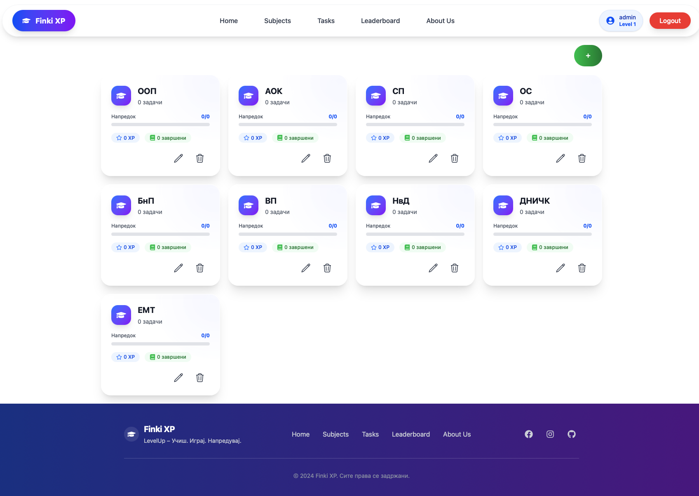
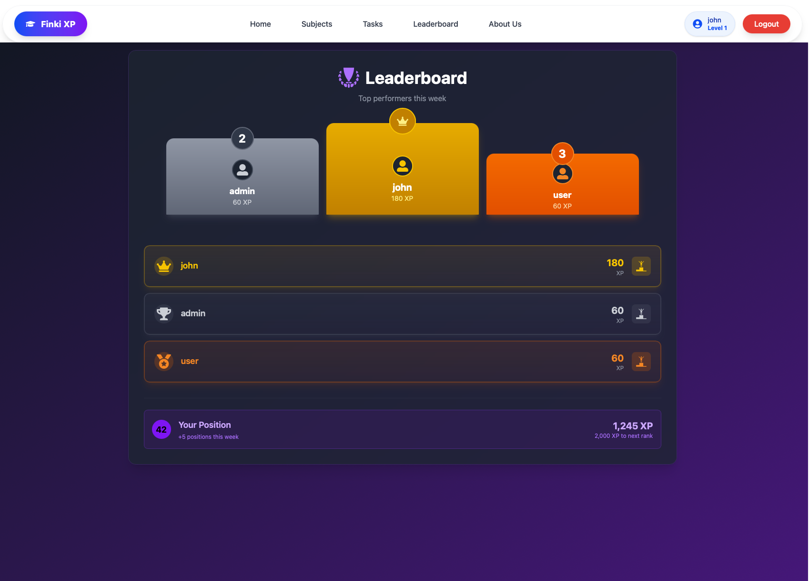

# FinkiXP — Gamified Learning Platform

<div align="center">

[](https://openjdk.org/projects/jdk/17/)
[](https://spring.io/projects/spring-boot)
[](https://react.dev/)
[](https://www.docker.com/)
[](https://kubernetes.io/)

</div>

FinkiXP is a modern web application that makes learning more engaging through gamification. Manage subjects and tasks, earn XP for completed work, track your level, and compete with other students on a live leaderboard.

## 📑 Contents

- [✨ Features](#-features)
- [🎬 Demo & Screenshots](#-demo--screenshots)
- [🚀 Quick Start with Docker](#-quick-start-with-docker)
- [🛠 Tech Stack](#-tech-stack)
- [📁 Project Structure](#-project-structure)
- [🏗 Docker Architecture](#-docker-architecture)
- [⚙️ Local Development (Manual)](#️-local-development-manual)
- [☸️ Kubernetes Deployment](#️-kubernetes-deployment)

---

## ✨ Features

- 🔐 **Authentication & roles** — JWT-based login and registration with protected routes.
- 📚 **Subject management** — create, edit, and delete subjects with an intuitive UI.
- ✅ **Task management** — create, edit, complete, and delete tasks with difficulty levels.
- 🏆 **XP, levels & leaderboard** — progress is tracked automatically and ranked on a leaderboard.
- 👤 **Profile page** — personal stats and account details in one place.
- 📖 **API documentation** — interactive Swagger UI shipped with the backend.
- 🐳 **One-command setup** — full stack runs locally via Docker Compose.
- ☸️ **Kubernetes ready** — manifests for namespace, configs, DB, backend, frontend, and ingress.

---

## 🎬 Demo & Screenshots

### Demo

<div align="center">


</div>

### Screenshots

<div align="center">




</div>

---

## 🚀 Quick Start with Docker

The entire ecosystem (Backend, Frontend, and Database) can be launched with a single command.

### Prerequisites

- [Docker](https://www.docker.com/get-started) installed
- [Docker Compose](https://docs.docker.com/compose/install/) installed

### Launch Command

Run the following command from the root directory of the project:

```bash
docker compose up -d --build
```

Once the containers are running, you can access the services at:

| Service | URL |
| --- | --- |
| **Frontend** | [http://localhost:3002](http://localhost:3002) |
| **Backend API** | [http://localhost:8085](http://localhost:8085) |
| **Swagger UI** | [http://localhost:8085/swagger-ui/index.html](http://localhost:8085/swagger-ui/index.html) |

To stop the stack and remove the containers:

```bash
docker-compose down
```

---

## 🛠 Tech Stack

### Backend

- **Java 17** with **Spring Boot 3.5.4**
- **Spring Data JPA** for persistence
- **Spring Security** with **JWT** for authentication
- **PostgreSQL 15** as the primary database
- **Lombok** for clean, concise code
- **springdoc-openapi** for API documentation

### Frontend

- **React 19** powered by **Vite 7**
- **TailwindCSS 4** for modern styling
- **React Router 7** for seamless navigation
- **Axios** for API communication
- **react-icons** and **react-countup** for the UI

---

## 📁 Project Structure

```text
FinkiXP/
├── backend/          # Spring Boot REST API, security, persistence
├── frontend/         # React + Vite single-page application
├── k8s/              # Kubernetes manifests
├── assets/           # Demo GIF and screenshots used in this README
│   ├── demo/
│   └── screenshots/
└── docker-compose.yml
```

---

## 🏗 Docker Architecture

The project utilizes three main services:

1. **`finkixp-db`** — a PostgreSQL 15 database instance exposed on port `2345`.
2. **`finkixp-backend`** — the Spring Boot application, configured with a healthcheck to ensure the database is ready before initialization.
3. **`finkixp-frontend`** — the React application served via Nginx, optimized for Single Page Application (SPA) routing.

---

## ⚙️ Local Development (Manual)

If you prefer to run the services individually, start the database first (e.g. `docker-compose up -d db`) and then:

### Backend

```bash
cd backend
./mvnw spring-boot:run
```

Runs on [http://localhost:8085](http://localhost:8085).

### Frontend

```bash
cd frontend
npm install
npm run dev
```

Runs on [http://localhost:3000](http://localhost:3000).

---

## ☸️ Kubernetes Deployment

You can deploy the entire application to a Kubernetes cluster (e.g., Docker Desktop, Minikube, or k3s).

### 1. Build Docker Images

First, build the images locally so the cluster can access them:

```bash
# Build Backend
docker build -t finkixp-backend:latest ./backend

# Build Frontend
docker build -t finkixp-frontend:latest ./frontend
```

### 2. Apply Manifests

Deploy the components in the following order:

```bash
# Create Namespace
kubectl apply -f k8s/namespace.yaml

# Apply Configs and Secrets
kubectl apply -f k8s/config-secrets.yaml

# Deploy Database
kubectl apply -f k8s/db-statefulset.yaml

# Deploy Backend
kubectl apply -f k8s/backend-deployment.yaml

# Deploy Frontend
kubectl apply -f k8s/frontend-deployment.yaml

# Apply Ingress (Optional)
kubectl apply -f k8s/ingress.yaml
```

### 3. Accessing the Application

#### Option A: Localhost (LoadBalancer)

If you are using Docker Desktop, the frontend is exposed on:

- **Frontend:** [http://localhost:3000](http://localhost:3000)

#### Option B: Ingress (Custom Domain)

If you have an Ingress Controller installed, add this to your `/etc/hosts` file:

```text
127.0.0.1 finkixp.local
```

Then access via: [http://finkixp.local](http://finkixp.local)

#### Option C: Port Forwarding

```bash
# Access Frontend
kubectl port-forward svc/finkixp-frontend 3000:3000 -n finkixp-ns

# Access Backend API
kubectl port-forward svc/finkixp-backend 8085:8085 -n finkixp-ns
```

### 🔍 Useful Commands

- **Check status:** `kubectl get pods -n finkixp-ns`
- **View logs:** `kubectl logs -f deployment/finkixp-backend -n finkixp-ns`
- **Delete everything:** `kubectl delete ns finkixp-ns`
